# Sports Intensity — Implementation Plan

Nov 7, 2026 · @Charles · Revised 7 Nov 2026 to add short-range prediction from video and audio (approved by the ML lead); revised the same day to run three coding agents in parallel

## Context and how to use this plan

Three coding agents build one fresh Python 3.12 repository, `sports-intensity`, in parallel. It ingests simulated live sports feeds, decodes their video and audio on one NVIDIA L4, and trains per-sport forecast models offline. Live, it serves one `ScoreUpdate` per feed per second to the front end, which ranks the feeds, with plain-word reasons and a warning when an intense moment is about to happen.

This plan supersedes the Global Plan's split into `intensity-engine` and `feed-decode-sim`, and Charles's decode build plan. Their content is folded in here. Five decisions changed the shape:

| Decision | Consequence for the build |
| --- | --- |
| One repository holds the engine and the ingest | One package, one schema module, one Python version (3.12), one Docker image with several entry points |
| The repository is fresh and three coding agents write all code in parallel | The Global Plan's Step 1 (schema, scorer, adapters, mock service, tests) is rebuilt here; nothing is copied from earlier repos. Each agent owns its own directories, and Charles merges their work (see Build order) |
| Every feed always has video | The decode pipeline's stream clock drives everything; there is no video-off mode, only a video part that drops out if the video model stalls |
| Ingest decodes video and audio once | Crowd loudness, voice features, commentary ASR and the video model all read from the ingest; nothing else opens the RTSP stream |
| Intense moments must be predicted before they happen | Two predictors: the trained forecast on match data warns tens of seconds to minutes ahead, and a rule-based `imminent` signal from video and audio build-up cues warns 2 to 10 s ahead (see Predicting intense moments) |

Unchanged from the Global Plan: the product goal, the sports and their labels, the clip-setting placeholders, the success criteria and the GCP VM facts. The ML lead still approves every contract change, label definition, clip setting and starting weight.

Roles around the agent:

- **ML lead:** approves contracts, labels, clip settings and weights; reviews training reports.
- **Charles:** owns the GCP project and VM; integrates, merging every agent's pull requests; reviews ingest and deployment work.
- **Teammate A:** video playback and hosting.
- **Teammate B:** the front end, which consumes the `ScoreUpdate` WebSocket.

Each agent builds its milestones in order and checks each one's done-when criteria before moving on. Where this plan and a library's real API disagree, the agent follows the library, records the difference, and tells a human.

## Scope, hard rules and non-goals

In scope for the hackathon: the feed simulator, GPU ingest of video and audio, perception (video v0 with shot type, sport prompts and pan speed; crowd loudness, rise rate and hush; commentator voice features; commentary ASR), the engine (adapters, scorer, forecasts, imminent rules, explanations, service), offline training for football, F1 and NBA, the weightlifting rules, the demo deployment on one L4 VM, and capacity experiment E3 with its chart.

Hard rules. A change that breaks one needs a human's approval first.

1. **No host copies.** Decoded frames never touch host memory in the GPU path. The only exception is explicit, sampled debug or validation output.
2. **Two processes, one boundary.** Ingest, decode, preprocessing, hand-off, the video model and ASR run in one GPU process with one CUDA context. The engine runs in a separate CPU process. Only `Event`, `ClockTick` and `Control` messages (numbers and short text) cross between them.
3. **One clock.** `t_video` is the position in the source mp4 in seconds, plus a `loop_epoch` counter. Every timestamp that crosses a module boundary is a `t_video`; sync tables map it to game time.
4. **Config, not constants.** Every model-facing setting and every tunable comes from config, and every run saves the config it used.
5. **Training equals serving.** Training features come from the same adapter code the live service runs. Video training clips come from the same preprocessing the live pipeline runs.
6. **Demo matches never train.** Every match, race or game used in the demo is excluded from training and used for testing.
7. **No invented numbers.** Every number in a reason comes from a fact the event carried. The fact guard rejects anything else.
8. **CPU path stays green.** `make test` passes on a laptop with no NVIDIA GPU and no network.
9. **Contracts are owned.** `Event`, `ClockTick`, `Control`, `ScoreUpdate`, `ClipBatch` and the model bundle change only with the ML lead's approval, recorded in `CHANGELOG.md`.
10. **Footage stays private.** Broadcast samples live in the private bucket and are never committed or published.

Non-goals for the hackathon:

- The front-end UI; the repo serves only a debug page.
- User preferences and personalisation (pitch slide only).
- Licensed live feeds, multi-GPU, auth and TLS.
- The full benchmark matrix (E1, E2, E4 to E8) and one-command GCP automation; both come after.
- Chess and the GRU forecast, unless approved as stretch goals by hour 16.

## Architecture and the single clock

Four containers share one G2 VM with an L4: MediaMTX, the feed pushers, a GPU ingest process and a CPU engine process. Viewers get video from MediaMTX and scores from the engine. All four come from one repo and one Docker image.

&#91;embedded content: runtime architecture · four processes on one L4 VM\]

Frames never leave the GPU process; the engine only ever sees events, clock ticks and control messages, and trained bundles arrive from the offline training CLI.

| Process | Entry point | Reads | Emits |
| --- | --- | --- | --- |
| `mediamtx` | MediaMTX binary | RTSP from the pushers | RTSP to ingest; HLS and WebRTC to viewers |
| `feeds` | `scripts/start_feeds.py` | Prepared mp4s on local disk | One looping RTSP stream per feed; `run/feeds_state.json` with each pusher's start time |
| `ingest` (GPU) | `python -m intensity.ingest.run` | RTSP video and audio per feed | `Event` (video, crowd, voice, commentary, ocr), `ClockTick` and `Control` to the engine's `/ingest` |
| `engine` (CPU) | `python -m intensity.engine.service` | `/ingest` messages, match-data JSONL, model bundles | `ScoreUpdate` on `/ws/scores`; `/feeds`, `/health`, `/debug` |

Why two processes: the ingest runs one Python thread per feed plus ASR, and the GIL would put the engine's 50 ms tick at risk. The engine needs no GPU, so a crash in one process never takes down the other.

**How `t_video` is established.** An RTSP reader's timestamps start wherever it joins the stream, not at the start of the mp4, so stream pts alone cannot be `t_video`. The ingest anchors each feed instead:

1. `start_feeds.py` writes each pusher's start time (host wall clock) and the mp4's duration to `run/feeds_state.json`.
2. On connect, the coarse anchor is `t_video = (t_wall_first_packet − pusher_start) mod duration`; after that, `t_video` advances by pts deltas.
3. The fine anchor (`ingest.clock.fine_anchor`, on by default) matches the first decoded frame against the source mp4 within ±2 s, using thumbnails decoded on CPU, and corrects the offset to one frame.
4. When `t_video` passes the duration or pts jumps backwards, `loop_epoch` increments, `t_video` wraps and a `Control(kind="loop")` goes to the engine.
5. The ingest publishes a `ClockTick` per feed at 4 Hz. The engine's per-feed clock is the last tick plus monotonic time since it arrived; a feed with no tick for 2 s is marked stale.

Match data never has its own clock: the engine's replayer releases each match event once the feed's clock passes that event's `t_video`, computed from game time through the sync table.

## Tech stack

Everything runs on Python 3.12; NVDEC, CUDA kernels, CTranslate2 and LightGBM do the heavy work. The agent pins exact versions in `uv.lock` once F0's environment check passes on the VM.

| Layer | Choice | Why |
| --- | --- | --- |
| Language and env | Python 3.12, `uv` for the environment and lock file | One version for engine and ingest; Ubuntu 24.04 ships 3.12 |
| Feed source | FFmpeg (libx264), `-re -stream_loop -1 -c copy` | Real-time pacing, light pushers |
| Media server | MediaMTX | RTSP in; HLS and WebRTC out for viewers; status API |
| GPU video decode | [PyNvVideoCodec](https://pypi.org/project/pynvvideocodec/2.2.2/) 2.2.x | Threaded low-latency decoder; 2.2.2 ships CPython 3.12 Linux wheels |
| CPU decode | PyAV | Laptop backend, audio decode, fine-anchor thumbnails |
| Tensors and video model | PyTorch 2.x, CUDA 12 build | Preprocessing on GPU; zero-copy import through DLPack |
| Commentary ASR | [faster-whisper](https://github.com/systran/faster-whisper) on CUDA, float16 | Current CTranslate2 needs cuBLAS and cuDNN 9 for CUDA 12; F0 checks it loads beside PyTorch |
| Shot type and prompts | open\_clip, a ViT-B/32 checkpoint (required) | Shot type (wide, close-up, replay) and sport prompts such as "athlete chalking hands" |
| Speech detection | The Silero VAD model faster-whisper uses, on CPU | Separates commentator speech from crowd noise every 0.5 s |
| Audio events (tier 2) | PANNs CNN14 on CUDA | AudioSet scores for cheering, applause, whistle, booing |
| Scoreboard OCR (tier 2) | A small OCR model on the GPU, chosen at build time | Clock, score, shot clock, lifter name and weight from fixed crops |
| Engine service | FastAPI, uvicorn, websockets, pydantic v2 | JSON over WebSocket in and out |
| Forecast models | LightGBM | Fast on CPU; exact tree SHAP through `pred_contrib` |
| Calibration and metrics | scikit-learn | Isotonic calibration, PR-AUC |
| Data sources | statsbombpy, fastf1, Jolpica HTTP API, nba\_api | The Global Plan's sources, unchanged |
| Tables | pandas, pyarrow (Parquet) | One file per build, reloadable |
| Reason polish (optional) | Anthropic API, model from config, off by default | Only output that passes the fact guard is used |
| Telemetry | nvidia-ml-py, psutil, CUDA events | NVDEC and SM use, stage timings |
| Report | matplotlib, Jinja2 | Static HTML that survives the VM |
| Config | YAML validated by pydantic | One file per run, saved with results |
| Quality | pytest with `gpu`, `net` and `slow` markers; ruff | CPU tests run anywhere |
| Packaging | Docker on an `nvidia/cuda` 12.x cuDNN 9 runtime base, Compose, NVIDIA Container Toolkit | Same image locally and on GCP |
| Cloud | One G2 VM with one L4, Cloud Storage | From the Global Plan |

One sourcing constraint shapes where builds run: stats.nba.com [throttles fast requests and does not answer many cloud IP ranges, GCP included](https://github.com/swar/nba_api/wiki/TV-Partners). NBA data builds therefore run on a laptop with a pause between requests, and the built tables go to the bucket.

## Predicting intense moments

The product has to warn viewers *before* an intense moment: a late break in football, two cars closing up in F1, a lifter stepping up to the bar. Match data can say a game is getting tense, but it can't see the build-up of a single moment: StatsBomb events have no "three attackers running at two defenders", and real live data feeds arrive seconds late. Video and audio have no delay, but most broadcast signals (roars, replays, celebration close-ups) come *after* a moment. So the plan uses two predictors with different warning windows, and sorts every video and audio cue by whether it comes before or after.

| Predictor | Warning window | Inputs | Built how | Answers |
| --- | --- | --- | --- | --- |
| `forecast` | Tens of seconds to minutes | Match data through the adapter | Trained LightGBM, calibrated (T1 to T3) | "Is this game in a state where something big is likely?" |
| `imminent` | 2 to 10 s | Video and audio building cues, plus a few adapter facts (F1 gaps, weightlifting attempt) | Per-sport rules, thresholds in config, tuned on non-demo footage (P4) | "Is it starting right now?" |

The forecast can't take video or audio features: there's almost no video lined up with the match data, and training must equal serving (hard rule 5). The two are joined late instead, by **cue × context**:

```text
cue      = sport rule over building cues, 0 to 1
ctx      = max(forecast part value, stakes part value)          # both already 0 to 1
context  = imminent.context_floor + (1 - context_floor) * ctx   # floor 0.3 by default
imminent_raw = cue * context
imminent = peak-hold of imminent_raw, decaying to 0 over imminent.hold_s (3 s)
```

The floor stops a real break in a dead game from scoring zero; the multiplier makes a break in the 88th minute at 1–1 score far above the same break at 3–0 in the 20th minute. Imminent is not smoothed by the intensity EMA, because it must react within a second.

- **Imminent heating up** is true when `imminent ≥ imminent.threshold` for at least `imminent.min_on_s` (1 s). The threshold is tuned per sport in P4.
- **Badge and auto-switch** fire when either `forecast.heating_up` or `imminent.heating_up` is true. `ScoreUpdate.heating_up` carries the OR, and `heating_up_by` says which.
- **As a part:** imminent is the eighth part of intensity, starting weight 0.15, so ranking leans towards feeds where something is starting.
- **Out-of-cycle updates:** `ScoreUpdate`s go out at 1 Hz, which would add up to 1 s of delay to a 2 to 10 s warning. When `imminent.heating_up` turns true, the engine sends that feed's `ScoreUpdate` immediately, at most once per `imminent.min_on_s`.

**Building cues and just-happened cues.** Building cues feed only the imminent rules. Just-happened cues feed only the `video`, `crowd` and `commentary` parts and, in evaluation, the automatic labels.

| Cue | Source | Group | Used by |
| --- | --- | --- | --- |
| Camera pan speed on wide shots, sustained | Video | Building | Imminent (football, NBA) |
| Sport prompts: "two racing cars close together", "onboard camera", "athlete chalking hands", "athlete standing over the barbell", "empty platform" | Video (open\_clip) | Building | Imminent (F1, weightlifting) |
| Commentator voice energy, pitch and pace rising | Audio | Building | Imminent (all sports) |
| Crowd rise rate (dB/s, in the gaps between speech) | Audio | Building | Imminent (football, NBA) |
| Crowd hush | Audio | Building | Imminent (weightlifting) |
| Celebration, close-up of player, close-up of crowd prompts | Video (open\_clip) | Just happened | `video` part, labels |
| Replay shot type | Video (open\_clip) | Just happened | `video` part hold rule (D7), labels; forces the imminent cue to 0 |
| Motion (frame difference) on wide shots | Video | Just happened | `video` part |
| Cuts per 10 s | Video | Neither | Shot boundaries only; weight 0 in the `video` part by default |
| Crowd loudness relative to baseline | Audio | Just happened | `crowd` part, labels (roar) |
| Audio events: cheering, applause, whistle, booing (tier 2) | Audio (PANNs) | Just happened | `crowd` part, labels |
| Whisper lexicon hits, player names | Commentary ASR | Just happened | `commentary` part and reasons only: a p95 lag of up to 3 s is too slow to predict |

## Contracts

Six contracts hold the repo together, and all live in code the agent writes in F1. `schema.py` exports JSON Schema to `contracts/` and contract tests fail on any undeclared change. Version 1 differs from the Global Plan in seven ways: `loop_epoch` everywhere, `t_video` and `stale` on `ScoreUpdate`, the `ClockTick` and `Control` messages, `payload.score` left null for the v0 video model, `forecast` as a seventh part (decided on 7 Nov 2026), `imminent` as an eighth part and a field, and the `voice` and `ocr` sources (both decided on 7 Nov 2026). The ML lead approves v1 at hour 0.

**Messages into the engine** (`src/intensity/schema.py`, one WebSocket frame per `Envelope` on `/ingest`):

```python
Sport = Literal["football", "f1", "nba", "weightlifting", "chess"]
Source = Literal["match", "crowd", "commentary", "video", "voice", "ocr"]
PART_NAMES = ("closeness", "momentum", "stakes", "crowd", "commentary", "video", "forecast", "imminent")

class Fact(BaseModel):
    key: str                      # "score_diff", "cuts_per_10s"
    value: float | int | str      # the exact value a reason may quote
    unit: str | None = None
    text: str                     # "France trail by one"

class Event(BaseModel):
    v: Literal[1] = 1
    feed_id: str
    sport: Sport
    source: Source
    t_video: float                # seconds into the source mp4
    loop_epoch: int
    t_emit_ns: int                # sender wall clock; latency metrics only
    payload: dict[str, Any]       # validated per source, below
    facts: list[Fact] = []

class ClockTick(BaseModel):      # ingest to engine, 4 Hz per feed
    feed_id: str
    t_video: float
    loop_epoch: int
    t_emit_ns: int

class Control(BaseModel):        # ingest to engine
    feed_id: str
    kind: Literal["loop", "feed_down", "feed_up"]
    loop_epoch: int
    t_emit_ns: int

class Envelope(BaseModel):
    kind: Literal["event", "clock", "control"]
    data: Event | ClockTick | Control
```

Payloads by source:

| Source | Producer | Payload fields |
| --- | --- | --- |
| `video` | Ingest, once per clip (every 0.5 s) | `clip_seq`, `t_video_start`, `motion`, `cuts_per_10s`, `shot_type` (`wide`, `close_player`, `close_crowd`, `replay`, `other`), `shot_conf`, `replay`, `replay_conf` (both from the shot type, never null), `prompts` (prompt to score), `pan_dx`, `pan_dy`, `pan_speed` (frame widths per second), `pan_sustained_s`, `score` (null for v0), `model` |
| `crowd` | Ingest, every 0.5 s | `window_s`, `loudness_dbfs`, `loudness_rel_db` (against the feed's rolling 60 s median), `peak_dbfs`, `nonspeech_dbfs`, `nonspeech_ok`, `rise_db_s`, `hush`, `events` (class to score, or null without PANNs) |
| `voice` | Ingest, every 0.5 s | `window_s`, `speech_frac`, `speaking`, `energy_rel_db`, `pitch_rel_st`, `pace_rel` (last three null when not speaking) |
| `ocr` (tier 2) | Ingest, at 1 Hz | `fields` (region name to text, for example `{"clock": "88:12", "score": "1-1"}`), `conf` per field |
| `commentary` | Ingest, per ASR segment | `text`, `t_start`, `t_end`, `lang`, `avg_logprob`, `no_speech_prob` |
| `match` | Engine replayer, from JSONL | `game_time_s`, `period`, `kind`, `team`, `player`, `attrs` (per-sport keys documented in each adapter) |

**Message out of the engine** (one `ScoreUpdate` per feed per second on `/ws/scores`):

```python
class PartValue(BaseModel):
    value: float                  # 0 to 1
    weight: float                 # effective weight after renormalisation
    contribution: float           # value * weight; contributions sum to intensity_raw
    phrase: str                   # "frantic camera action"
    facts: list[Fact]

class Forecast(BaseModel):
    p: float                      # calibrated probability of the sport's label
    label: str                    # "big_chance", "on_track_pass", "lead_change"
    horizon_s: float
    source: Literal["model", "heuristic", "rule"]
    heating_up: bool              # p at or above the bundle's threshold
    model_version: str | None

class Imminent(BaseModel):
    value: float                  # 0 to 1, after peak-hold
    cue: float                    # 0 to 1, before context
    context: float                # context_floor to 1
    heating_up: bool              # value >= threshold for min_on_s
    phase: str | None             # weightlifting only: "idle", "walk_on", "setup", "setup_hush", "lift"
    source: Literal["rule"]       # "model" reserved for later
    facts: list[Fact]             # the cues behind it

class Reason(BaseModel):
    text: str
    facts: list[Fact]             # at least 2; every number in text appears here
    factors: list[str]            # parts or model features behind it
    polished: bool

class ScoreUpdate(BaseModel):
    v: Literal[1] = 1
    feed_id: str
    sport: Sport
    t_video: float
    loop_epoch: int
    game_clock: str | None        # "88:12", "Lap 41/58", "Q4 2:31"
    t_emit_ns: int
    stale: bool                   # no ClockTick for 2 s
    intensity_raw: float          # sum(w_i * part_i) / sum(w_i) over present parts
    intensity: float              # EMA, alpha = 0.3
    intensity_pct: float          # 0 to 100 within sport; the front end ranks on this
    trend: Literal["rising", "steady", "falling"]
    trend_slope: float            # per second over the last 10 s
    parts: dict[str, PartValue | None]   # every PART_NAMES key; None = dropped out
    forecast: Forecast
    imminent: Imminent
    heating_up: bool              # forecast.heating_up or imminent.heating_up
    heating_up_by: list[Literal["forecast", "imminent"]]
    reasons: list[Reason]         # at most 3
```

The forecast is both a part and a field. As the seventh part, its value is the calibrated `p` passed through the sport's validation distribution (quantiles stored in the bundle), so a rare-event probability sits on the same 0 to 1 scale as the other parts. Weightlifting uses `1 − |2p − 1|`, which peaks when a lift is a coin flip. The `forecast` field keeps the raw calibrated `p` and, together with `imminent`, drives the "heating up" badge and auto-switch. The forecast's features overlap with momentum, so its starting weight is modest (0.2) and tuned in D2. The `imminent` part's value is `Imminent.value`, starting weight 0.15.

**`ClipBatch`** (`src/intensity/ingest/handoff.py`, in-process only), unchanged from the decode build plan:

```python
@dataclass
class ClipBatch:
    video: torch.Tensor           # [B, T, C, H, W], RGB, cuda:0, contiguous, normalised
    audio: torch.Tensor | None    # GPU mel [B, n_mels, frames] only if a model needs it
    sport: str
    feed_ids: list[str]
    clip_seq: list[int]
    t_video_start: list[float]
    t_video_end: list[float]
    loop_epoch: list[int]
    t_last_packet_ns: list[int]
    t_ready_ns: int
    dropped_since_last: list[int]
    ready: torch.cuda.Event       # the consumer waits on this before reading
```

Each feed has a latest-wins slot; a per-sport batcher takes the freshest clip from each feed, up to `batch.max_size`. Clip settings come from config, with the Global Plan's placeholders: 16 frames at 8 fps, 0.5 s stride, 224 x 224, float16, ImageNet mean and std.

**`config/feeds.yaml`**, the one feed registry that MediaMTX paths, pushers, ingest and engine all read:

```yaml
feeds:
  - feed_id: fb-arg-fra
    sport: football
    sample: samples/arg_fra_2022_final.mp4    # path inside the bucket and data/samples/
    rtsp_path: fb-arg-fra
    match_ref: {source: statsbomb, match_id: null}   # filled by the ML lead
    sync: data/sync/arg_fra_2022_final.csv
    asr: live                                 # live | precomputed | off
    ocr_regions: null                         # tier 2: {clock: [x, y, w, h], score: [...]} at 1080p
```

**Sync tables** (`data/sync/<clip_id>.csv`, committed): `clip_id, video_start, video_end, game_start, period`. Each row is a segment of continuous play, and game time inside it is `game_start + (t_video − video_start)`. Gaps between rows (replays, breaks, cuts) have no game time, and the replayer holds. NBA rows use elapsed game-clock seconds, so stoppages become separate rows.

**Model bundles** (`models/<sport>/<version>/`, committed; LightGBM text files are small):

```text
model.txt         LightGBM booster
calibrator.json   isotonic calibration points
meta.json         ordered feature list, feature_hash, label, horizon_s, threshold, p_quantiles,
                  train/val/test match ids, metrics, data_hash, git_sha, created_at
../CURRENT        one line naming the version to serve
```

## Repository layout

One repo, one importable package `intensity`, four entry points (ingest, engine, training CLI, benchmark). Raw data, built tables and samples are never committed; they sync to the private bucket.

```text
sports-intensity/
├── pyproject.toml, uv.lock, Makefile, README.md, CHANGELOG.md, .env.example
├── config/
│   ├── default/                  # ingest.yaml, perception.yaml, engine.yaml, training.yaml, merged by the loader
│   ├── feeds.yaml                # the one feed registry
│   ├── weights.yaml              # part weights per sport, including video and imminent
│   ├── prompts/<sport>.yaml      # open_clip shot-type and sport prompts
│   ├── imminent/<sport>.yaml     # imminent cue weights, thresholds, phase settings
│   ├── lexicon/<sport>.yaml      # commentary keywords
│   ├── local.yaml, demo.yaml     # overlays: laptop (CPU backend, mock) and VM demo
│   └── experiments/E3.yaml
├── contracts/                    # JSON Schema exported from schema.py, checked in
├── data/
│   ├── sync/<clip_id>.csv        # committed, hand-made
│   ├── highlights/<match>.yaml   # committed, hand-made highlight lists for the check
│   ├── weightlifting/<session>.csv   # committed, hand-entered results
│   └── raw/ events/ tables/ transcripts/ tapes/ samples/   # gitignored, synced to the bucket;
│                                     # samples/tuning/<sport>/ holds non-demo tuning clips
├── models/<sport>/<version>/     # committed LightGBM bundles; video head weights stay in the bucket
├── make/    engine.mk, training.mk, ingest.mk   # one per agent, included by the root Makefile
├── status/  engine.md, training.md, ingest.md   # one per agent, kept current
├── docker/  Dockerfile, compose.yaml, compose.demo.yaml, mediamtx.yml
├── scripts/ prepare_samples.sh, start_feeds.py, sync_bucket.sh
├── src/intensity/
│   ├── schema.py, config.py, feeds.py, sync.py, transport.py, telemetry.py
│   ├── ingest/
│   │   ├── rtsp.py               # demux, TCP, reconnect, anchor, loop epochs
│   │   ├── clock.py              # ClockTick publisher
│   │   ├── decode/  base.py, nvdec.py, pyav_cpu.py
│   │   ├── preprocess.py, window.py, handoff.py
│   │   ├── audio.py              # PCM decode and resample, per-feed ring buffer
│   │   └── run.py                # python -m intensity.ingest.run
│   ├── perception/
│   │   ├── video_v0.py, video_head.py (optional), loudness.py, asr.py
│   │   ├── shot.py               # open_clip shot type and sport prompts
│   │   ├── pan.py                # phase-correlation pan speed
│   │   ├── voice.py              # VAD, energy, pitch, pace; non-speech crowd level, rise, hush
│   │   ├── audio_events.py       # tier 2, PANNs
│   │   ├── ocr.py                # tier 2
│   │   └── consumers.py          # dummy consumers and the real video consumer
│   ├── engine/
│   │   ├── adapters/  base.py, football.py, f1.py, nba.py, weightlifting.py
│   │   ├── trackers/  crowd.py, commentary.py, video.py, voice.py
│   │   ├── imminent/  base.py, football.py, f1.py, nba.py, weightlifting.py
│   │   ├── scorer.py, forecast.py, registry.py, replay.py, feedstate.py, mock.py
│   │   ├── explain/  templates.py, phrases.py, guard.py, polish.py
│   │   └── service.py            # python -m intensity.engine.service
│   └── training/
│       ├── sources/  statsbomb.py, f1.py, nba.py, weightlifting.py
│       ├── featurize.py, labels.py, split.py, train.py, calibrate.py, evaluate.py, export.py
│       ├── video_clips.py, video_train.py   # optional trained video head
│       ├── imminent_eval.py      # automatic labels and the imminent check
│       └── cli.py                # python -m intensity.training.cli <command>
├── bench/   offline_decode.py, run_matrix.py, validate.py
├── report/  analyze.py, charts.py, build.py, templates/
├── infra/gcp/  create_vm.sh, setup_vm.sh, run_demo.sh, run_bench.sh, teardown.sh, env.example
└── tests/   unit/, contract/, integration/ (gpu, net), fixtures/
```

Makefile targets the agents must provide: `test`, `test-gpu`, `lint`, `env-check`, `feeds-up`, `ingest`, `engine`, `mock`, `demo`, `build-<sport>`, `train-<sport>`, `eval-<sport>`, `eval-imminent`, `record-tapes`, `video-calibrate`, `transcripts`, `clock-check`, `sync-sheet`, `bench-e3`, `report`.

## Build order and timeline

Three coding agents build the repo in parallel after a two-hour foundation, each in its own directories, and Charles merges their work. Real video events reach the engine at hour 12, the demo runs end to end at hour 16, and every agent keeps at least two flexible hours before the freeze.

**Why parallel.** The serial schedule had no slack: F1 training ended at hour 18.5 and NBA at 19.5, and D2 tuning and E3 got 30 minutes each. The work splits cleanly into engine, training and ingest, which meet only at the contracts. The price is coordination, handled by the rules below. Parallel works only if Charles can merge through the day and the ML lead can review three streams; if not, run the same milestones serially and start the cut order early.

| Agent | Machine | Owns | Milestones |
| --- | --- | --- | --- |
| Engine | Laptop, CPU only | `src/intensity/engine/` except `adapters/`; `config/imminent/`, `config/lexicon/`, `config/default/engine.yaml` | F0, F1, S1, S2 replay, S3, S4, P4 |
| Training | Laptop on a non-cloud network, CPU only | `src/intensity/training/`, `src/intensity/engine/adapters/`, `models/`, `data/highlights/`, `data/weightlifting/`, `config/default/training.yaml` | T0, S2 adapters, T1 to T4, the parity test, T5 if approved |
| Ingest | The L4 VM (a laptop until hour 4) | `src/intensity/ingest/`, `src/intensity/perception/`, `config/prompts/`, `config/default/ingest.yaml`, `config/default/perception.yaml`, `scripts/`, `docker/`, `infra/`, `bench/`, `report/` | I1 to I6, P1 to P3, tier 2, D1, B1 |

Each agent also owns its tests (`tests/unit/<agent>/`), its `make/<agent>.mk` and its `status/<agent>.md`. Shared files are `schema.py`, `config.py`, `feeds.py`, `sync.py`, `transport.py`, `telemetry.py`, `config/feeds.yaml`, `config/weights.yaml`, `contracts/`, `pyproject.toml`, `uv.lock`, the root `Makefile` and `CHANGELOG.md`.

**How the agents work together.**

- **Contract first.** The engine agent builds F0 and F1 alone. F1 includes the mock generator and stub adapters, so the engine never waits on ingest or training. The training and ingest agents start at hour 1 on work that needs only F0 (T0 and I1), and rebase onto F1 at hour 2.
- **Small pull requests.** One branch per milestone or smaller, merged into `main` by Charles once CI is green. Each agent rebases on `main` before every milestone.
- **Ownership.** An agent never edits another agent's directories; it opens an issue for the owner instead. A shared file changes only in a PR of its own. A contract or weight change also needs the ML lead's approval, and every agent rebases right after it merges.
- **Event tapes.** From hour 13 the ingest agent records each tuning and demo clip's events to a tape (I6). The engine agent tunes and evaluates the imminent rules by replaying tapes on CPU; before that it uses the mock generator and the test clip's events.
- **One GPU, one user.** Only the ingest agent uses the demo VM's L4. E3 runs alone in B1, and T5, if approved, gets its own Spot L4 from Charles.

```mermaid
gantt
    title Three agents in parallel, hours from the start
    dateFormat HH:mm
    axisFormat %H:%M
    section Engine agent
    F0 Scaffold and env check       :e0, 00:00, 60m
    F1 Contracts and mock           :e1, 01:00, 60m
    S1 Scorer core                  :e2, 02:00, 60m
    S2 Replay and sync sheet        :e3, 03:00, 60m
    S3 Reasons and service          :e4, 04:00, 120m
    S4 Trackers                     :e5, 06:00, 180m
    P4 Imminent rules               :e6, 09:00, 240m
    P4 Evaluation on tapes          :e7, 13:00, 120m
    D1 and D2 support               :e8, 15:00, 270m
    section Training agent
    T0 Data fetchers                :t0, 01:00, 60m
    S2 Adapters                     :t1, 02:00, 180m
    T1 Football                     :t2, 05:00, 180m
    T2 F1                           :t3, 08:00, 180m
    T3 NBA                          :t4, 11:00, 150m
    T4 Weightlifting                :t5, 13:30, 60m
    Parity test and references      :t6, 14:30, 90m
    T5 Video head if approved       :t7, 16:00, 240m
    section Ingest agent
    I1 Feed simulator               :i1, 01:00, 60m
    I2 Decode and clock anchor      :i2, 02:00, 180m
    I3 Preprocess and window        :i3, 05:00, 90m
    I4 Hand-off and multi-feed      :i4, 06:30, 90m
    I5 and P1 Audio crowd voice     :i5, 08:00, 120m
    P3 Video v0                     :i6, 10:00, 120m
    I6 Event tapes                  :i7, 12:00, 60m
    P2 Commentary ASR               :i8, 13:00, 90m
    D1 Demo end to end              :i9, 14:30, 90m
    Tier 2 if ahead                 :i10, 16:00, 120m
    B1 Capacity run E3              :i11, 19:30, 90m
    section Everyone
    D2 Tuning                       :d2, 16:00, 210m
    D3 Freeze and rehearsal         :d3, 21:00, 180m
    section Gates
    Mock end to end                 :milestone, g1, 06:00, 1m
    Real events live                :milestone, g2, 12:00, 1m
    Demo end to end                 :milestone, g3, 16:00, 1m
    Freeze                          :milestone, g4, 21:00, 1m
```



The chart shows planned hours. Each agent starts a milestone only once its previous one meets its done-when.

Gates, each checked by a human:

| Hour | Gate | Needs |
| --- | --- | --- |
| 0 | Contracts v1 approved; clip settings confirmed; L4 quota requested | ML lead, Charles |
| 2 | F1 merged; the training and ingest agents rebase onto it; downloads running | Engine agent, training agent |
| 4 | L4 VM up; the ingest agent moves to it; environment check passing | Charles, ingest agent |
| 6 | Mock end to end: Teammate B's front end renders `ScoreUpdate`s from mock events | S3 |
| 12 | Real video, crowd and voice events reach the engine live; tuning footage in the bucket (D13) | P1, P3, S4, ML lead |
| 13 | Event tapes for every tuning and demo clip | I6 |
| 16 | Demo end to end with commentary and imminent; every sport on an approved bundle or the heuristic; stretch call | D1, P4, T1 to T4, ML lead |
| 21 | Freeze: fixes only, then rehearsal | Everyone |

**Background jobs.** Each agent starts long jobs, notes the log path in its status file, and keeps coding.

- Training agent: StatsBomb, FastF1 and NBA downloads from hour 2, and each sport's training search.
- Engine agent: imminent evaluation runs over all tapes.
- Ingest agent: `make video-calibrate`, the 30-minute soak at the end of D1, and the E3 runs.

**Human tasks the schedule relies on.** Charles creates the VM by hour 4 and merges each green PR within about 30 minutes. The ML lead reviews training reports, imminent reports and contact sheets as they land, and puts the tuning footage, sync tables and highlight lists in the bucket by hour 12. No teammate laptop is needed for NBA: the training agent fetches it from its own laptop.

**Cut order.** If an agent falls more than an hour behind, it cuts its own items in this order and says so in its status file:

| Order | Item | Agent |
| --- | --- | --- |
| 1 | T5, the trained video head | Training |
| 2 | Tier 2 scoreboard OCR | Ingest |
| 3 | Tier 2 PANNs audio events; labels then use loudness only | Ingest |
| 4 | T3: NBA serves the heuristic forecast | Training |
| 5 | Voice pitch; energy and pace stay | Ingest |
| 6 | T2: F1 serves the heuristic forecast | Training |
| 7 | Live ASR: every feed uses precomputed transcripts | Ingest |
| 8 | B1 shrinks to the decode-only mode | Ingest |

Never cut: open\_clip shot type and prompts, pan speed, voice energy and pace, crowd rise rate and hush, and the imminent rules. The engine agent's work is all never-cut; if it slips, Charles can move its imminent evaluation to the training agent, which has the most slack after hour 16.

## Foundation (F0 to F1)

The engine agent builds the foundation alone, by hour 2, so all three agents share one package, config, contracts and test harness. The other two start at hour 1 on work that needs only F0 (T0 and I1).

**F0, scaffold and environment check** (hour 0 to 1).

- `pyproject.toml` for Python 3.12 with `uv`. Base dependencies: fastapi, uvicorn, websockets, pydantic, pyyaml, numpy, pandas, pyarrow, av, httpx. Extras: `gpu` (torch CUDA 12 build, pynvvideocodec, faster-whisper, nvidia-ml-py, open\_clip) and `train` (lightgbm, scikit-learn, statsbombpy, fastf1, nba\_api).
- Config loader with overlays (`default` + `local` or `demo` + CLI overrides), `feeds.yaml` loader, structured JSON logging.
- Dockerfile on an `nvidia/cuda` 12.x cuDNN 9 runtime base with Ubuntu 24.04 and FFmpeg; Compose skeleton with MediaMTX.
- `make env-check`: `nvidia-smi`; an FFmpeg NVDEC smoke test with decoder utilisation above zero; PyNvVideoCodec decoding one frame into a CUDA tensor through DLPack; faster-whisper loading a tiny model on CUDA in the same process after PyTorch has initialised CUDA; LightGBM importing. It writes an environment snapshot (GPU, driver, CUDA, cuDNN, library versions) to JSON.
- CI (GitHub Actions) running `make lint test` on CPU.
- Per-agent files so agents rarely touch the same one: `config/default/<area>.yaml` merged by the loader, `make/<agent>.mk` included by the root `Makefile`, `tests/unit/<agent>/` and `status/<agent>.md`. F0 also declares every dependency this plan names, so the shared lock file seldom changes.
- Done when `make test` passes on a laptop with no GPU, the image builds, and `make env-check` passes on the VM as soon as it exists.

**F1, contracts and mock** (hours 1 to 2).

- `schema.py` exactly as in Contracts, the JSON Schema export, and contract tests: round trip, fixtures per source, and a schema snapshot that fails on undeclared changes.
- `transport.py`: WebSocket client with reconnect and a bounded send queue. Under pressure it drops the oldest `ClockTick`s first and never drops `match` events.
- `engine/mock.py`: a deterministic generator of plausible events for every source, including `video`, `ClockTick` and `Control`, for any feed list.
- `engine/adapters/base.py`, the adapter interface, with a stub adapter per sport that returns plausible parts and a constant feature row, so the engine agent never waits on the training agent.
- Sample `ScoreUpdate` JSON in `contracts/samples/` for Teammate B, and the v1 entry in `CHANGELOG.md`.
- Done when contract tests pass, the mock emits valid envelopes for four feeds across all sources, and the samples are in the repo.

## Ingest (I1 to I6): video and audio decode

The ingest turns each RTSP feed into GPU clips, a PCM ring buffer and a clock, in one process. It carries over the decode build plan's M1 to M5, and adds the audio lane, which is now required, and event tapes for the engine agent (I6).

`prepare_samples.sh` also generates a synthetic test clip: a counter burned into every frame, plus a white flash and a 1 kHz beep every 5 s. It also has a segment that pans at a known speed, a tone that sweeps in pitch, and an 8 dB level drop, for the pan, voice and hush tests. CPU tests, the clock check and the audio-alignment check all use it, so they never need broadcast footage.

**I1, feed simulator** (hours 1 to 2, laptop).

- `prepare_samples.sh` transcodes each sample to 1080p30 H.264 with `-tune zerolatency`, a 1 s GOP, no B-frames and AAC audio, and records each duration.
- `start_feeds.py` reads `feeds.yaml` and starts one pusher per feed: `ffmpeg -re -stream_loop -1 -i <mp4> -c copy -f rtsp -rtsp_transport tcp rtsp://mediamtx:8554/<rtsp_path>`. It writes `run/feeds_state.json`, restarts dead pushers, and takes `--clones N` to duplicate feeds for E3.
- Done when every feed plays in VLC, `ffprobe` reports `has_b_frames=0`, and `feeds_state.json` matches the running pushers.

**I2, single-feed decode and clock anchor** (hours 2 to 5: the PyAV backend on the laptop first, NVDEC on the VM from hour 4).

- `rtsp.py`: PyAV demux over TCP with low-delay options, split into video and audio packet streams, reconnect with backoff, the anchor and loop logic from the Architecture section.
- `decode/nvdec.py`: PyNvVideoCodec in low-latency mode fed with demuxed packets, frames imported into PyTorch through DLPack. `decode/pyav_cpu.py` implements the same interface. The agent reads the samples shipped in the wheel before coding against the API.
- `clock.py`: a `ClockTick` per feed at 4 Hz, and `Control` messages on loop, feed down and feed up.
- Done when decoded fps is at least the source fps, every frame is on `cuda`, decoder utilisation is above zero, and NVDEC frames reach at least 40 dB PSNR against PyAV on 100 frames. A killed feed must recover within 5 s. `make clock-check` must show the anchor within one frame on the test clip, and `loop_epoch` must increment on each loop.

**I3, preprocessing and sliding window** (hours 5 to 6.5).

- Select frames by `t_video` at `clip.sample_fps`, convert to RGB (the decoder's RGB output if available), short-side resize, centre crop, normalise and cast to float16. Each feed runs on its own CUDA stream and writes into a pre-allocated GPU ring buffer, which emits a clip every `clip.stride_s`.
- Done when clip starts are spaced by the stride within one frame, GPU memory stays flat over 10 minutes, and a contact sheet of de-normalised clips shows correct colour, orientation and aspect.

**I4, hand-off and multi-feed** (hours 6.5 to 8).

- `ClipBatch`, latest-wins slots, the per-sport batcher, and two dummy consumers: one sleeps N ms, one burns a share of SM time.
- One ingest thread and one CUDA stream per feed, with feeds from `feeds.yaml`.
- Telemetry: per-frame (sampled), per-clip and 4 Hz system records to Parquet, as specified in the decode build plan.
- Done when a consumer slower than the clip rate keeps clip age bounded with drops visible in metrics, and the demo feeds plus clones run 10 minutes without errors.

**I5, audio lane** (hours 8 to 10, with P1).

- Audio packets are decoded with PyAV, resampled to 16 kHz mono float32, and written to a 60 s ring buffer per feed, indexed by `t_video`. Consumers read any window `[t0, t1]`.
- A GPU mel spectrogram is built only if `audio.gpu_mel` is on, which stays off unless a video model takes audio.
- Done when beeps in the test clip land within 20 ms of their flashes, and 10 minutes run with no audio gaps.

**I6, event tapes** (hours 12 to 13).

- `make record-tapes SET=tuning|demo` runs the ingest and perception in offline file mode over each clip, and writes every `Event`, `ClockTick` and `Control` they would have sent to `data/tapes/<clip_id>.jsonl`.
- Tapes are exactly the live ingest's output, so the engine agent can build, tune and evaluate the imminent rules on CPU without the GPU.
- Done when every tuning and demo clip has a tape in the bucket, and replaying a tape through the engine gives the same imminent spikes as running its clip live, within 0.5 s.

## Perception (P1 to P4): audio, commentary, video and the imminent rules

Perception runs inside the ingest process and turns clips and PCM into `Event`s of numbers and short text. None of it is trained here; it uses pretrained models and signal processing only. Normalisation to 0 to 1 happens in the engine's trackers, per sport, so one sport's camera style or broadcast mix never skews another's. All features obey hard rule 1: frames stay on the GPU, and only per-window scalars and short text leave it. P4, the imminent rules, runs in the engine and is described at the end of this section because it consumes these features.

**P1, crowd and voice** (hours 8 to 10, with I5; the engine agent's crowd and voice trackers consume it).

- **Crowd loudness.** Every 0.5 s, over the last 1 s of PCM: RMS level in dBFS, peak, and the level relative to the feed's rolling 60 s median. The broadcast mix includes the commentator, so this level measures broadcast loudness; it feeds the just-happened `crowd` part.
- **Speech detection.** The Silero VAD that faster-whisper uses, run on CPU at the same 0.5 s cadence, separate from ASR. `speech_frac` is the share of the window marked as speech.
- **Crowd without the commentator.** `nonspeech_dbfs` is the level of the window's non-speech frames only. When `speech_frac` is above 0.8, it carries the last valid value with `nonspeech_ok: false`. `rise_db_s` is the least-squares slope of `nonspeech_dbfs` over the last `crowd.rise_window_s` (3 s). `hush` is true when `nonspeech_dbfs` falls at least `crowd.hush_drop_db` (6 dB) below the feed's 60 s median within 2 s.
- **Commentator voice** (the `voice` source), from speech frames only, each relative to the feed's rolling 120 s median:
  - energy: RMS in dB (`energy_rel_db`);
  - pitch: median F0 by YIN over 70 to 400 Hz, in semitones (`pitch_rel_st`);
  - pace: voiced-onset rate as a ratio (`pace_rel`).

  With `speech_frac` below `voice.min_speech_frac` (0.3), the window carries `speaking: false` and null energy, pitch and pace.
- Facts carried: for example `loudness_rel_db = 8.4`, with the text "crowd 8 dB above normal", or `rise_db_s = 3.1`, "crowd rising 3 dB a second".
- Done when:
  - the test clip's beeps show as spikes at the right `t_video`;
  - pitch tracks the test clip's tone sweep within half a semitone, and the voice fields are null on silence;
  - hush fires on the 8 dB drop and not on a 3 dB one, and rise rate matches a synthetic ramp;
  - each `crowd` and `voice` event leaves within 100 ms of its window's end.

**P2, commentary ASR** (hours 13 to 14.5). ASR feeds the `commentary` part and reasons only, never the imminent rules: its lag is too long to predict with.

- One faster-whisper model on CUDA in float16, in the ingest process, serving every feed with `asr: live`. Every `asr.step_s` (1.5 s) it transcribes the last `asr.window_s` (4 s) of each feed's PCM with VAD on. Only segments ending after the last emitted end are kept, so overlapping windows never repeat words.
- Model size and language come from config: start with a small English model, measure lag, and move up only if lag allows.
- `make transcripts` runs the same `asr.py` offline over each sample and writes `data/transcripts/<clip_id>.jsonl`. With `asr: precomputed`, the ingest replays those segments as the feed's clock passes them, with the same event shape.
- Commentary lag is emit time minus the arrival time of the segment's last audio. Done when p95 lag is under 3 s on every live feed with video running, and live and precomputed events share one shape.

**P3, video model v0** (hours 10 to 12).

- The real consumer in `perception/consumers.py` takes each sport's `ClipBatch`, waits on `ready`, and computes per clip:
  - **motion:** mean absolute difference between consecutive frames, on de-normalised luma downsampled to 112 x 112;
  - **cuts:** a luma and hue histogram distance between consecutive frames above `video_v0.cut_threshold`. Clips overlap (2 s window, 0.5 s stride), so each cut is stored once per feed by its `t_video`. `cuts_per_10s` counts the last 10 s. Cuts mark shot boundaries for pan and for the shot-type vote; they carry weight 0 in the `video` part by default;
  - **shot type and prompts (required):** open\_clip ViT-B/32 on the middle frame, re-normalised to CLIP statistics on the GPU. Prompts live in `config/prompts/<sport>.yaml` in two groups. The shot-type prompts (wide, close-up of player, close-up of crowd, replay, other) become one `shot_type` by softmax and a majority vote over the last 3 clips; `replay` is true when the shot type is replay. The sport prompts ("goal celebration", "two racing cars close together", "onboard camera", "athlete chalking hands", "athlete standing over the barbell", "empty platform" and so on) are each reported as a score in `prompts`;
  - **pan speed:** global camera translation between consecutive sampled frames (8 fps) by phase correlation, an FFT cross-power spectrum on luma downsampled to `video.pan.size` (128 x 128), in PyTorch on the GPU. Reported as `pan_dx` and `pan_dy` in frame widths per second, and `pan_speed` as their magnitude. Pairs that span a cut are skipped. `pan_sustained_s` is how long the pan has stayed above `video.pan.min_speed` with an unchanged direction on its dominant axis, counted only while `shot_type == "wide"`.
- One `video` event per clip, with `t_video` at the clip's end and its measurements as facts.
- `make video-calibrate` runs v0 over every sample, tuning clips included, through the same preprocessing in offline file mode. It writes per-sport distributions of motion, cut rate, pan speed, prompt scores and voice features to `models/video_v0/calibration.json`, which seed the engine's video, voice and imminent percentiles.
- Budget: under 25 ms per batch including open\_clip and pan, measured with CUDA events; pan alone adds under 2 ms.
- Done when:
  - events arrive at 2 Hz per feed with the right `t_video`;
  - on a synthetic clip with known cuts, the cut detector finds at least 90% of them, with at most one false cut per minute on static footage;
  - phase correlation recovers the test clip's known pan within 5%, and skips pairs across cuts;
  - a contact sheet of shot types on the demo and tuning clips looks right to the ML lead.

**Tier 2 perception** (only if ahead of schedule; first and second to cut after T5).

- **Audio events:** PANNs CNN14 on the GPU over 1 s windows at 2 Hz. It computes its own log-mel internally, so `audio.gpu_mel` (D8) stays off. AudioSet scores for cheering, crowd, applause, whistle and booing go into the `crowd` payload's `events`.
- **Scoreboard OCR:** per-feed crop regions in `feeds.yaml` (`ocr_regions`), read at 1 Hz on the GPU into the `ocr` source. Uses: a sync check (the read clock against the sync table, shown on `/health`), the weightlifter's name and weight, and the NBA shot clock. If the chosen OCR library needs host images, stop and ask Charles before adding any exception to hard rule 1.

**P4, imminent rules and evaluation** (engine agent: rules in hours 9 to 13 on mock and test-clip events, evaluation on event tapes in hours 13 to 15).

Rules live in `src/intensity/engine/imminent/<sport>.py`, with every threshold and weight in `config/imminent/<sport>.yaml`. Each cue first becomes 0 to 1 through a per-sport percentile, seeded from `calibration.json` and updated per feed over a rolling 5 minutes, as the crowd tracker does. A rule reads only cues and facts at or before the tick time. The combination with context is in Predicting intense moments.

| Sport | Cue (before × context) | Notes |
| --- | --- | --- |
| Football | 0.5 × `pan` + 0.25 × `crowd_rise` + 0.25 × `voice_rise` | `pan` is the pan-speed percentile, counted only when `shot_type == "wide"` and `pan_sustained_s ≥ 1.5`. `voice_rise` is the mean of the energy and pitch percentiles while speaking. The cue is 0 during replays |
| F1 | 0.4 × `battle_shot` + 0.4 × `gap_close` + 0.2 × `voice_rise` | `battle_shot` is the higher of the "two racing cars close together" and "onboard camera" prompt percentiles. `gap_close` is 1 when the adapter's smallest gap among the top cars is under 1 s, falling linearly to 0 at 2 s. The cue is 0 during replays |
| NBA | 0.5 × `pan` + 0.25 × `crowd_rise` + 0.25 × `voice_rise` | As football, with a sustained pan of at least 1 s for fast breaks |
| Weightlifting | Phase value, below | Context is `1 − |2p − 1|` from the rule-based p(success) |

Weightlifting phases come from a small state machine driven by prompt scores, each held for 1 s before the phase moves:

| Phase | Enter when | Cue |
| --- | --- | --- |
| `idle` | "empty platform" leads | 0 |
| `walk_on` | An athlete prompt leads after `idle` | 0.4 |
| `setup` | "athlete chalking hands" or "athlete standing over the barbell" leads | 0.7 |
| `setup_hush` | `setup` and crowd `hush` | 1.0 |
| `lift` | A pan or motion spike on the platform after `setup` | 1.0, then decays over `hold_s` |

The session CSV's ETA stays as a prior: if the video hasn't reached `walk_on` within 30 s of the ETA, the cue holds 0.2 until it does. The phase goes into `Imminent.phase` and a fact such as "athlete at the bar".

Imminent adds reason templates such as "fast break on a wide shot, crowd rising 3 dB a second" or "two cars nose to tail, gap 0.4 s". The fact guard applies unchanged.

**Evaluation.** `make eval-imminent SPORT=<sport> SET=tuning|demo` replays the clips' event tapes (I6) through the engine on CPU and writes `reports/imminent/<sport>/<rule_version>/report.html`.

- **Automatic labels.** A moment is any of:
  - from match data: a football goal or a shot with xG ≥ 0.1, an F1 on-track pass, an NBA lead change, a weightlifting lift start from the session CSV;
  - from just-happened cues: a crowd roar (`loudness_rel_db` above its 95th percentile for at least 1 s, or a PANNs cheering score above 0.5), a replay starting, a celebration prompt leading.

  Moments within 10 s of each other merge into one, at the earliest time. Where the ML lead has hand-marked build-up start times, the report also shows lead time against those.
- **Spikes** are each time `imminent.heating_up` turns true, at least 10 s after the last. A spike is a **hit** if it comes 2 to 10 s before a moment.
- **Reported:** precision, recall, median lead time and false alarms per 10 minutes, per sport and per clip, with a timeline of `imminent` and the moments marked.
- **Starting targets** (D14): precision ≥ 0.4, median lead time ≥ 2 s, at most 2 false alarms per 10 minutes.
- **Tuning** happens only on `SET=tuning`. The demo clips are scored once per rule version, reported beside the forecast's highlight check, and never used to tune (hard rule 6). A sport with no tuning footage keeps its config defaults, and the report says so.

**P4 done when:** every sport's rule passes its unit tests, `make eval-imminent SET=tuning` runs end to end for every sport with tuning footage, the demo report is generated once, an imminent crossing reaches `/ws/scores` within 200 ms through the out-of-cycle update, and the debug page shows `imminent` and its phase per feed.

## Engine plan, part 1: prior training (T1 to T5)

Every forecast model is trained before the demo from the same match-record streams the demo replays, through the same adapter code the live service runs. Each run ends in a versioned bundle and a report the ML lead signs off before it is served. Training needs no GPU except the optional video head.

**The training pipeline**, one command per step (`python -m intensity.training.cli <step> --sport <sport>`), each step cached and resumable:

1. **Source.** `training/sources/<sport>.py` downloads raw data to `data/raw/<sport>/` and converts each match to `data/events/<sport>/<match_id>.jsonl`. Each line is a match record: the `match` payload plus game time, the exact shape the live replayer turns into `Event`s.
2. **Featurize.** `featurize.py` replays each match's records through the live adapter on a fast-forward clock and calls the same `features()` the service calls, once per second of game time. Output: `data/tables/<sport>/features.parquet` with `match_id`, `game_time_s` and the ordered feature columns.
3. **Label.** `labels.py` looks forward along the same record stream from each tick. A row whose horizon runs past the end of a period with no positive is dropped, since its outcome is unknown.
4. **Split.** `split.py` groups by match with a fixed seed. Demo matches from `feeds.yaml` always go to test, plus 15% of the other matches; 15% go to validation and the rest to training. The build fails if a demo match lands in training or validation.
5. **Train.** LightGBM binary with `scale_pos_weight` = negatives / positives, early stopping on validation average precision, and a capped search of at most 20 settings (leaves, minimum data per leaf, feature fraction, learning rate). Budget: about 10 minutes per sport on a laptop.
6. **Calibrate.** Isotonic regression on validation predictions, saved as `calibrator.json`. The "heating up" threshold is the lowest calibrated `p` whose validation precision reaches 3 times the base rate, capped so at most 15% of ticks qualify.
7. **Evaluate on test.** The checks are:
   - PR-AUC against the base rate (target: at least 2 times) and lift in the top 5% of ticks;
   - a reliability curve and Brier score;
   - global SHAP: mean absolute `pred_contrib` for the top 15 features, read for leakage;
   - the highlight check: the 10 highest forecast peaks in each demo match, 60 s apart, against `data/highlights/<match>.yaml`. A peak counts as a hit if it comes 0 to 45 s before a listed highlight, and the target is at least 6 of 10;
   - a per-match timeline of `p` with the highlights marked.

   Everything goes into `reports/training/<sport>/<version>/report.html`.
8. **Export.** Write the bundle described in Contracts and open a PR with the report. `CURRENT` moves to the new version only after the ML lead approves.

Leakage guards are tests, not conventions:

- A property test shuffles every record after `t` and checks that the features at `t` do not change.
- Labels read only records after `t`.
- The split assertion above keeps demo matches out of training and validation.
- The feature list and its hash are stored in the bundle and checked again at load time.

**T0, data fetchers** (hours 1 to 2). The download half of step 1 for all three sports, written first so downloads run in the background from hour 2. The training agent runs on a laptop, so all three fetchers run there, NBA's included, and raw files sync to the bucket. Done when each fetcher downloads one match, race or game and resumes after an interruption.

**Per sport:**

| Milestone | Sport | Data and scope | Example features at each tick | Label and horizon | Held out |
| --- | --- | --- | --- | --- | --- |
| T1 (hours 5 to 8) | Football | StatsBomb open data, 2022 World Cup, 64 matches; more competitions only with the ML lead's OK | Score difference, minute, period, shots and xG per team over the last 2 and 5 min, final-third entries, box touches, possession share, pressures, corners, cards, last event type and location | Shot with xG ≥ 0.1 or a goal within 30 s | Argentina v France final, plus 15% |
| T2 (hours 8 to 11) | F1 | FastF1 2019 to 2024 plus Jolpica for results and pit stops | Gaps to the car ahead for the top cars, battles within 1 s, tyre age and compound gaps in battles, laps remaining, safety car or VSC status, recent position changes | On-track pass, excluding pit-stop swaps, within 2 laps (about 180 s) | The demo race, plus 15% of races |
| T3 (hours 11 to 13.5) | NBA | `nba_api` PlayByPlayV3, two recent seasons plus playoffs, built on a laptop | Margin, time remaining, period, scoring run over the last 2 min, fouls and bonus, timeouts left, last event type | Lead change or tie within 60 s of game clock | The demo game, plus 15% |
| T4 (hours 13.5 to 14.5) | Weightlifting | Hand-entered session CSV | Attempt weight against the athlete's best and entry total, attempt number, standings gap | Rule-based p(success), no model | n/a |

T4 also writes the session's replay JSONL and the ETAs that the engine agent's imminent phase machine (P4) reads. Its done-when includes checking lifting order, ETAs and phases against the video. Chess, if approved, is rule-based on Stockfish evaluation swings.

Until a sport's bundle exists, the engine uses a per-sport heuristic forecast on the same adapter features, marked `source: "heuristic"`, so the service works from hour 6.

**Done when** (T1 to T3): the build, featurize, train and evaluate steps run end to end from a clean cache with one command, PR-AUC on test is at least 2 times the base rate, the highlight check hits at least 6 of 10, and the ML lead has approved the PR that moves `CURRENT`. A sport that misses its target ships with the heuristic, and the report says so.

**T5, trained video head (optional, training agent: only if approved at hour 16; it needs GPU time on a second Spot L4 from Charles, never the demo VM; first in the cut order).**

- **Clips:** `video_clips.py` decodes the samples through the ingest's offline file mode, with the same preprocessing and clip settings, at a 1 s stride.
- **Labels:** the sync table maps each clip's end to game time. The target is the sport's forecast label, or the engine's match-only intensity at that moment as a regression target. Clips that fall in sync-table gaps are excluded.
- **Model:** a frozen pretrained video backbone whose input matches the clip settings (for example a 16-frame, 224 x 224 model with ImageNet normalisation; the ML lead picks it). Embeddings are cached, and a logistic or two-layer head is trained on top. It is saved to the bucket as `video_head/<version>/` with the backbone id and a hash of the clip settings.
- **Evaluation:** leave one match out, since the footage is mostly the demo clips. The head is served in the demo only if every held-out match clears the same 2 times base-rate bar; otherwise it goes on the pitch slide.

## Engine plan, part 2: real-time scoring and model deployment (S1 to S4)

The engine is one async FastAPI process. Once a second it reads each feed's clock, advances that feed's match replay, updates its trackers, scores it, forecasts, runs the imminent rule, explains and broadcasts. An imminent crossing triggers an extra, out-of-cycle update for that feed. Trained models deploy as bundles loaded at startup with a feature check, and every model has a fallback that keeps the demo running.

**S1, scorer core** (hours 2 to 3).

- `feedstate.py` holds each feed's state: its clock from `ClockTick`s, `loop_epoch`, adapter, trackers, EMA, a 10 s trend buffer and its last `ScoreUpdate`.
- `scorer.py`: `intensity_raw` is the weighted mean over present parts with weights from `weights.yaml`, renormalised when parts drop out. The forecast part comes from the calibrated probability through the bundle's quantiles, or from the heuristic until a bundle exists. The imminent part comes from `Imminent.value` (P4) and is 0 until P4 lands. The EMA uses alpha 0.3; `imminent` itself is never smoothed by it. `heating_up` is the OR of the forecast's and imminent's flags. The trend is the least-squares slope over the last 10 s, with rising and falling thresholds from config.
- `intensity_pct` is the percentile within the sport over a rolling 30 minutes. It is seeded from `intensity_ref.json`, which training writes by scoring held-out matches, so the percentile is meaningful from the first tick.
- On `Control(kind="loop")` the feed's adapter, replay cursor, trackers, imminent state (including the weightlifting phase), EMA and trend reset; the sport's percentile history is kept.
- Done when unit tests cover renormalisation, EMA, trend sign and loop reset, and the tick takes under 5 ms per feed at p95 on a laptop with mock input.

**S2, sport adapters and replay** (adapters: training agent, hours 2 to 5; replay and sync sheet: engine agent, hours 3 to 4).

- `adapters/base.py` interface: `reset()`, `on_match(record)`, `features(game_time)` over a fixed ordered `FEATURES` list, `parts(game_time)` returning closeness, momentum and stakes with phrases and facts, `game_clock()` and `heuristic_forecast()`. The four adapters implement it, and the ML lead reviews each part's definition.
- `replay.py` loads a feed's match records, maps game time to `t_video` through the sync table, and releases records as the clock passes them, holding in gaps.
- `make sync-sheet CLIP=<id>` renders the sample's frames at the `t_video` of every goal, shot or pass in the match data, so a human can check the sync table by eye.
- Done when each adapter passes tests on fixture matches, replay emits records at the right `t_video` on a synthetic sync table, and the sync sheet renders for the football demo clip.

**S3, reasons and service** (hours 4 to 6).

- `explain/`: rank factors by part contribution and by the forecast's per-feature SHAP, and turn the top three into sentences from `phrases.py` templates filled only from facts.
- `guard.py` pulls every number and proper name out of a sentence, checks each appears in the facts, and requires at least two facts. A sentence that fails falls back to its template.
- `polish.py` (off by default) sends the template and facts to the LLM with a 1.5 s timeout and guards the result. It never blocks a tick; the latest passing polish is used when ready.
- `service.py` endpoints:
  - WebSocket `/ingest`, validating every envelope;
  - WebSocket `/ws/scores`, where a slow client gets only the latest update instead of a queue;
  - `/feeds`, and `/health`, which shows staleness, last-event age per source and model versions per feed;
  - `/metrics` (JSON counters and latency histograms);
  - `POST /admin/reload`, and `/debug`, a plain HTML page with parts bars per feed.
- `make mock` runs the engine on the mock generator, so Teammate B can build against it.
- Done when Teammate B's front end renders mock updates (the hour-6 gate), the guard rejects a sentence with an invented number in tests, and 30 minutes of four feeds at 1 Hz show no memory growth.

**S4, perception trackers** (hours 6 to 9, on mock and test-clip events; checked against real events at the hour-12 gate). Trackers turn just-happened cues into the `crowd`, `commentary` and `video` parts, and keep the per-feed percentiles of building cues that the imminent rules read.

- **Crowd:** `loudness_rel_db` becomes a 0 to 1 part through a per-feed rolling percentile over 5 minutes; with PANNs on, cheering and applause scores raise it. It also keeps percentiles of `rise_db_s` and passes `hush` through.
- **Voice:** keeps per-feed percentiles of `energy_rel_db`, `pitch_rel_st` and `pace_rel` while speaking. It is not a part of its own: it only feeds the imminent rules and reasons.
- **Commentary:** a per-sport lexicon (`config/lexicon/<sport>.yaml`: "goal", "chance", "penalty", "overtake" and so on), player names from the match records, and speech rate. The result decays over 10 s, and a fact may quote up to six words of the transcript.
- **Video:** per-sport percentiles of motion on wide shots and of the celebration and close-up prompt scores, seeded from `calibration.json` and combined with config weights (cut rate at weight 0 by default). It also keeps the pan and sport-prompt percentiles the imminent rules read. While `replay` is true the part holds its pre-replay value and adds the fact "replay showing". The part drops out after 3 s with no events. When `payload.score` is present (the T5 head), it replaces the v0 combination.
- Done when tracker unit tests pass and, at the hour-12 gate, the real ingest's events move the parts and the cue percentiles on the debug page.

**Deploying the forecast models.**

- `registry.py` loads each sport's `CURRENT` bundle at startup and checks the feature list and hash against the adapter's `FEATURES`. On a mismatch it logs the error, serves the heuristic, and says so in `/health`.
- Per tick and feed: one pre-allocated feature row, `booster.predict`, isotonic calibration, and `pred_contrib` for the explanation. Target: under 2 ms.
- `POST /admin/reload` (or SIGHUP) swaps bundles atomically between ticks. `forecast.shadow: <version>` scores a second bundle and logs it without serving it, to compare a retrained model live.
- **Parity test:** with `engine.clock: simulated` at 20 times speed, the service replays each demo match. Its forecasts must match the offline evaluation's for the same match within 1e-6. This is the direct proof that training equals serving. The training agent owns this test and writes `intensity_ref.json` alongside it.

**Deploying perception models.** The v0 video model, open\_clip and Whisper all run in the ingest process. Their weights are downloaded at image build time, so nothing downloads on stage. `perception.video.model: v0 | head` selects the video model. The head loads only if its clip-settings hash matches the live config, and falls back to v0 otherwise.

**Switches for the stage**, set in config and through `/admin`: `perception.video.enabled`, `asr` per feed (`live`, `precomputed` or `off`), `engine.polish.enabled`, `engine.forecast.source` (`model` or `heuristic`), and `engine.imminent.enabled`. With the video model disabled, imminent runs on audio cues alone and says so in its facts.

**Latency budget**, measured end to end and reported on `/metrics`:

| Stage | Budget |
| --- | --- |
| Clip ready after its last packet | p95 under 50 ms |
| Video v0 per batch, including open\_clip and pan | under 25 ms |
| `crowd` and `voice` events after their window ends | under 100 ms |
| Ingest to engine message on the same host | under 20 ms |
| Engine tick per feed, all stages | under 50 ms (target 5 ms) |
| Imminent rule per feed per tick | under 1 ms |
| Imminent crossing to `/ws/scores` (out-of-cycle update) | under 200 ms |
| Commentary lag | p95 under 3 s |
| Tick to all WebSocket clients | under 10 ms |

## Demo deployment, capacity benchmark and rehearsal (D1 to D3, B1)

The demo runs from one Compose file on one standard (not Spot) G2 VM. The capacity number comes from experiment E3, run on the same VM outside demo time, because it saturates the GPU.

**VM**, from the Global Plan and Charles's build plan:

- `g2-standard-16` with one L4, Ubuntu 24.04, `pd-balanced` 100 GB, Secure Boot off and `--maintenance-policy=TERMINATE`.
- Driver R580 via `cuda_installer.pyz`.
- Spot for development, standard for the demo and the headline E3 run, with a watchdog shutdown.

**D1, demo end to end** (hours 14.5 to 16, ingest agent, with the other two on call).

- `docker/compose.demo.yaml` runs `mediamtx`, `feeds`, `ingest` (with GPU access) and `engine`. Each service has a restart policy and a health check: the engine's `/health`, and a small `/health` the ingest serves on its own port.
- `infra/gcp/setup_vm.sh` installs the driver, Docker and the Container Toolkit, then pulls the image, samples, transcripts and video calibration from the bucket. `run_demo.sh` starts the stack and runs `make env-check` and `make clock-check`.
- Viewer access: the engine's port and MediaMTX's HLS and WebRTC ports (WebRTC also needs its UDP port) are opened only to the team's addresses, or proxied by Teammate A's host. Nothing else is exposed.
- Done when all demo feeds score end to end for 30 minutes with every part present, imminent included, the video part rises at the big moments on each sync sheet, the imminent cues move on the debug page, and Teammate B's front end ranks and auto-switches on live data.

**D2, tune and verify** (hours 16 to 19.5, ML lead with the engine agent). The ML lead tunes `weights.yaml`, including `video` and `imminent`, by watching clips with the `/debug` overlay, reads the imminent reports, and checks every sync table with `make sync-sheet`. Each weight change is a commit with a `CHANGELOG.md` line.

**B1, capacity experiment E3** (hours 19.5 to 21, ingest agent, alone on the GPU).

- Feed scaling at 1, 2, 4, 8, 16, 32 and 64 cloned feeds, stopping once real time is lost, in two modes:
  - decode, preprocessing and a dummy consumer, as in the decode build plan;
  - the full perception stack (v0 with open\_clip and pan, crowd, voice) plus live ASR on the demo feeds.
- Each configuration runs three times for 120 s, with the first 10 s discarded.
- Headline numbers per mode: maximum real-time feeds per L4, p95 clip latency at the target count, and cost per feed-hour (the VM's hourly price from `env` divided by sustained feeds).
- `make report RUN=<id>` builds the feed-scaling chart and headline table as static HTML from the Parquet files alone.
- Done when the report is in the bucket and its numbers are on the pitch slide. The rest of the matrix (E1, E2, E4 to E8) and one-command GCP automation come after the hackathon.

**D3, freeze and rehearsal** (hours 21 to 24). Two full rehearsals, each with these drills:

- ASR switched to precomputed mid-run;
- the video model disabled, so the part drops out cleanly and imminent carries on with audio cues alone;
- the ingest killed and restarted, so feeds go stale and then recover;
- the engine restarted, so the front end reconnects.

Done when every drill recovers within 10 s with `ScoreUpdate`s still flowing for the healthy feeds.

## Testing and verification

The whole pipeline runs on a laptop in CI from the synthetic test clip, through the PyAV backend, perception and the engine, to a `ScoreUpdate`, in under 2 minutes. GPU and network tests run on the VM and are skipped elsewhere.

| Layer | What it proves | Runs | Marker |
| --- | --- | --- | --- |
| Unit | Scorer maths, adapters on fixture matches, trackers, fact guard, sync mapping, clock anchor and loop maths, latest-wins slots, batcher | Everywhere, every commit | none |
| Contract | JSON Schema snapshot unchanged unless declared; fixtures for every source validate; Teammate B's samples validate | Everywhere | none |
| Unit (perception) | Phase correlation recovers a known pan within 5% and skips cuts; pitch tracks a tone sweep within half a semitone; voice fields null on silence; hush fires on 8 dB and not 3 dB; rise rate matches a ramp | Everywhere | none |
| Unit (imminent) | Each sport's rule on fixture cues; the weightlifting state machine's transitions and ETA prior; peak-hold and `min_on_s`; the `heating_up` OR | Everywhere | none |
| Leakage | Features at `t` unchanged when later records are shuffled; `imminent` at `t` unchanged when later cues are shuffled; demo matches never in training, validation or imminent tuning | Everywhere | none |
| CPU pipeline | Test clip to clips to v0, crowd and voice events to engine to `ScoreUpdate`, with a non-zero `imminent` during the pan segment, in file mode without MediaMTX | CI | none |
| No host copies | A PyTorch dispatch-mode guard fails the test on any device-to-host copy in the GPU path; every decoded frame is on `cuda` | VM | `gpu` |
| Decode quality | NVDEC against PyAV, at least 40 dB PSNR on 100 frames | VM | `gpu` |
| Clock and audio | `make clock-check` within one frame; beeps within 20 ms of flashes | VM | `gpu` |
| ASR lag | p95 commentary lag under 3 s with video running | VM | `gpu` |
| Imminent latency | An imminent crossing reaches `/ws/scores` within 200 ms | VM | `gpu` |
| Imminent check | `make eval-imminent` replays the tuning tapes for every sport that has them | Laptop | `slow` |
| Tape parity | Replaying a clip's tape through the engine gives the same imminent spikes as running the clip live, within 0.5 s | VM | `slow`, `gpu` |
| Data sources | One match, race or game per source downloads and converts | Laptop | `net` |
| Serve parity | The live service's forecasts on each demo match equal the offline evaluation's within 1e-6 | Laptop | `slow` |
| Soak | The demo stack runs 30 minutes: memory flat, no stale feeds, no reconnect storms | VM | `slow`, `gpu` |
| Drills | The four D3 fallbacks recover within 10 s | VM | manual, scripted |

Every milestone PR lists which done-when checks passed and the command that ran them.

## Risks and mitigations

The biggest risks are a late GPU, a wrong clock and three agents drifting apart. Each has a fallback that keeps the demo running.

| Risk | Effect | Mitigation |
| --- | --- | --- |
| No L4 quota or zone capacity | No VM by hour 4 | Request at hour 0 in two regions; the CPU backend keeps ingest, engine and training work moving |
| PyTorch and CTranslate2 CUDA libraries clash in one process | ASR fails to load | F0's environment check catches it; fallback is ASR in a third process reading PCM over a local socket |
| GIL caps the ingest's threads | Feeds fall behind real time | Watch per-core CPU in E3; shard feeds across two ingest processes, each with its own models |
| RTSP joins mid-stream; pushers start late | Reasons point at the wrong moment | Fine anchor by frame matching, `make clock-check`, the counter test clip |
| Sync tables off on highlight edits or stoppages | Match events land at the wrong `t_video` | One row per continuous segment; `make sync-sheet` reviewed by the ML lead |
| A demo match leaks into training | Inflated metrics, a misleading demo | Split assertion driven by `feeds.yaml` |
| A data source fails or its API changed | A sport has no model | Heuristic fallback; tell the ML lead and propose an alternative; never swap silently |
| stats.nba.com ignores cloud IPs | NBA build fails on the VM | Build on a laptop with pauses; cache tables in the bucket |
| FastF1 downloads are slow | T2 runs late | Start downloads right after F1; cache in the bucket; trim seasons if needed, with the ML lead's OK |
| v0 video signals mean different things per sport | The video part misleads | Per-sport percentiles, starting weight about 0.15, the replay hold rule |
| The commentator dominates the broadcast mix | The crowd part partly tracks commentary | Crowd rise and hush measured only in non-speech frames; the plain level stays relative to the feed's own baseline; limitation documented |
| No tuning footage by hour 12 | Imminent thresholds are untuned guesses | Gate at hour 12; config defaults; the imminent report says the sport is untuned |
| Imminent fires too often | False alarms make the badge and auto-switch jumpy | `min_on_s`, the context multiplier, replay gating, and the false-alarm target in P4; the front end adds its own dwell time |
| Broadcast directors or commentators differ in style | Pan and voice cues mean different things per broadcast | Per-feed rolling baselines and percentiles; tuning clips from more than one broadcaster where possible |
| open\_clip prompts misread shot types | Wrong phases or pan gating | Prompt wording tested on hand-picked stills per shot type; contact sheet review in P3 |
| Whisper lags on stage | Commentary reasons arrive late | Precomputed transcripts, switchable per feed |
| HLS playback runs seconds behind live | The badge fires before viewers see anything | `ScoreUpdate.t_video` lets the front end delay rendering (decision D3) |
| Three agents drift apart | Merge conflicts, broken contracts, a late integration | Directory ownership, the contract-first fork at hour 2, small PRs through CI, one integrator, a rebase before every milestone |
| Reviews pile up on the ML lead and Charles | Agents wait on approvals | Agents build on defaults and never block on a review; Charles merges within about 30 minutes of a green CI; reviews are checked at each gate |
| Agents compete for the one L4 | Tests collide; E3 numbers are skewed | Only the ingest agent uses the demo VM's GPU; the engine agent works from event tapes; E3 runs alone; T5 gets its own Spot L4 |
| Broadcast footage is copyrighted | Licensing exposure | Private bucket only; nothing committed or published |
| VM left running | Cost | Watchdog shutdown, teardown script, budget alert |

## Open decisions

Six decisions were settled on 7 Nov 2026 (D1, D4, D9, D11, D12, D14), and D9 was revised later that day; eight are still open. The agent builds on each default until an owner changes it, and every change is recorded in `CHANGELOG.md`.

| ID | Decision | Default the agent uses | Owner | Decide by | Status |
| --- | --- | --- | --- | --- | --- |
| D1 | Is the forecast a weighted part of intensity, or a separate signal? | Decided: the forecast is a weighted seventh part, starting weight 0.2; the `forecast` field drives the badge and auto-switch together with `imminent` (D11) | ML lead | Hour 0 | Changed |
| D2 | Clip settings | Placeholders: 16 frames, 8 fps, 0.5 s stride, 224 x 224, float16, ImageNet normalisation | ML lead | Hour 0 | Open |
| D3 | Playback protocol, and whether the front end delays scores to match playback | WebRTC from MediaMTX; the front end holds each update until playback reaches its `t_video` | Teammates A and B | Hour 6 | Open |
| D4 | Trained video head (T5): demo or pitch slide | Optional phase after hour-16 approval, on a second Spot L4; in the demo only if every held-out match clears the bar | ML lead | Hour 16 | Default accepted |
| D5 | Which feeds get live ASR, and which Whisper size | Live on every demo feed with a small English model; precomputed transcripts ready as fallback | ML lead, Charles | Hour 14.5, after P2's lag numbers | Open |
| D6 | Starting `video`, `forecast` and `imminent` weights per sport | Video 0.15, forecast 0.2 and imminent 0.15 for every sport, until D2 tuning | ML lead | Hour 12 | Open |
| D7 | Video part during replays | Hold the pre-replay value and add the fact "replay showing"; the imminent cue is 0 during replays | ML lead | Hour 12 | Open |
| D8 | Does any model take audio (GPU mel spectrogram)? | No; `audio.gpu_mel: false` (PANNs, if used, computes its own mel) | ML lead | Hour 16 | Open |
| D9 | One agent session or parallel agents | Decided: three agents in parallel (engine, training, ingest), each owning its directories, with Charles integrating (see Build order) | Charles | Hour 0 | Changed |
| D10 | LLM polish: on or off, and which model | Off; when on, the Anthropic API with the model and key from `.env`, guarded | ML lead | Hour 16 | Open |
| D11 | Is imminent a part, a separate signal, or both? | Decided: both, the eighth part (weight 0.15) and its own field, ORed with the forecast for the badge and auto-switch | ML lead | Hour 0 | Changed |
| D12 | Imminent context floor and hold | `context_floor` 0.3, `hold_s` 3 s, `min_on_s` 1 s | ML lead | Hour 0 | Default accepted |
| D13 | Tuning footage per sport | At least two non-demo clips per sport with match data and sync tables, in the bucket by hour 12 | ML lead | Hour 12 | Open |
| D14 | Starting imminent targets | Precision ≥ 0.4, median lead time ≥ 2 s, at most 2 false alarms per 10 minutes | ML lead | Hour 0 | Default accepted |

## Working rules and definition of done

Each agent works milestone by milestone, verifies before moving on, and reports what it measured rather than what it expected.

Working rules:

- Open a PR at the end of each milestone, listing the done-when checks that passed and how they ran.
- Work only in your own directories (see Build order). A change another agent's code needs is an issue for its owner; a change to a shared file is a PR of its own that Charles merges.
- Rebase on `main` before starting each milestone, and keep `status/<agent>.md` current: milestone, done-when evidence, blockers.
- Read each installed library's docs and bundled samples before coding against it (PyNvVideoCodec ships samples in the wheel). Never guess method names; if an API differs from this plan, adapt and record the difference.
- No `.cpu()`, `.numpy()` or other host copies in the GPU path; the dispatch-mode guard test enforces it.
- No magic numbers: every tunable comes from config, and every run saves the config it used.
- Contracts change only with the ML lead's approval, recorded in `CHANGELOG.md` and flagged in the commit message.
- Keep `make test` green on a machine with no GPU and no network.
- Report honestly: a missed target is stated with its data. The test split is scored once per model version and never used to tune.
- Never commit footage, raw data or secrets. Secrets live in `.env` or Secret Manager. The README credits the data sources as their terms require.
- Ask a human before:
  - creating cloud resources beyond the scripted VM, or extending a run past the watchdog;
  - adding a data source or competition;
  - changing a label or horizon;
  - moving a `CURRENT` pointer;
  - starting a stretch goal;
  - adding a dependency (ask Charles, at any hour, because the lock file is shared).

Definition of done:

- [ ] `make test` passes on a CPU laptop and `make test-gpu` passes on the VM
- [ ] Football, F1 and NBA serve approved bundles, or the heuristic with a report saying why
- [ ] The serve parity test passes for every demo match
- [ ] Every sport has an imminent report on its tuning footage (or says it has none) and one scored run on its demo clip
- [ ] The demo stack runs 30 minutes end to end on the L4 VM with every part present, and all four drills pass
- [ ] The E3 report, with feeds per L4 and cost per feed-hour, is in the bucket
- [ ] The README covers running the mock locally, running the demo on the VM, training a sport, adding a feed and consuming `/ws/scores`
- [ ] The contracts in this plan, the code and `contracts/` JSON Schema all match

Sources checked on 2026-11-07: [PyNvVideoCodec 2.2.2 on PyPI](https://pypi.org/project/pynvvideocodec/2.2.2/), [faster-whisper](https://github.com/systran/faster-whisper), [nba\_api hosting notes](https://github.com/swar/nba_api/wiki/TV-Partners).
